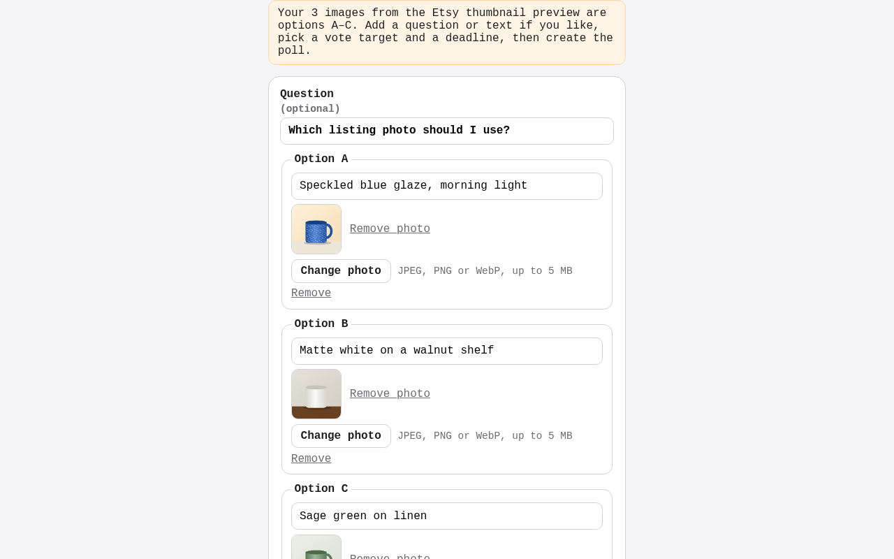
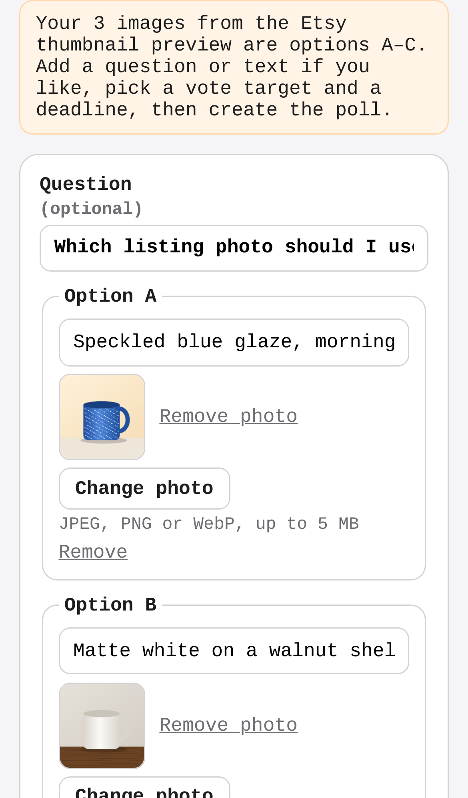

# tiebreak — swipe-to-decide polls for indecisive people and sellers

## Screenshots

The free Etsy thumbnail preview (`/tools/etsy-thumbnail-preview`): three listing photos added from the device show side by side at the 1:1, 4:3 and 5:4 crops, drawn by the browser with nothing uploaded. The book cover and YouTube tools work the same way.

The core action, "Let strangers pick": the photos upload and the new-poll form opens with them as options A–C and the tool's question filled in.

Its result: the poll is live, with the three photos loading from tiebreak, ready to share.

Regenerate them with `npm run screenshots` (set `CHROMIUM_PATH` to a Chromium binary; it starts the dev server on an in-memory database, with sample data only; the three mug photos are drawn in the browser).

People post two options, strangers swipe to pick one, and the poll closes at a vote target or deadline; sellers and creators pay a few dollars for a fast verdict instead of PickFu's $15+.

- [Research](RESEARCH.md) — findings and sources
- [PRD](PRD.md)
- [Roadmap](ROADMAP.md)
- [Native app](mobile/README.md): iPhone and Android (Expo), on the same API. Run it on your phone with Expo Go.
- Free tools: [Etsy thumbnail preview](https://tiebreak-phi.vercel.app/tools/etsy-thumbnail-preview), [book cover thumbnail test](https://tiebreak-phi.vercel.app/tools/book-cover-thumbnail-test) and [YouTube thumbnail preview](https://tiebreak-phi.vercel.app/tools/youtube-thumbnail-preview): 2–4 candidates side by side, then a poll in one click ([GROWTH.md](GROWTH.md)).

Effort: Medium · Confidence: Low

_Researched by the idea pipeline on 2026-10-11 ([original record](https://github.com/smithdavedesign/idea-factory/tree/main/ideas/tiebreak)); repo created on David's go-ahead 2026-10-11._

## Starter content (house polls)
The public feed is stocked with 40 funny "house" polls (`lib/house.ts`: horse-sized duck, is a hot dog a sandwich, …). Each question keeps one open public poll; when it closes, the next feed read posts a fresh copy, so the feed never runs dry. People's polls always come first, and anyone who voted on a house question doesn't see it again. Edit the list to change them; `HOUSE_POLLS=off` in the Vercel env turns them off.
