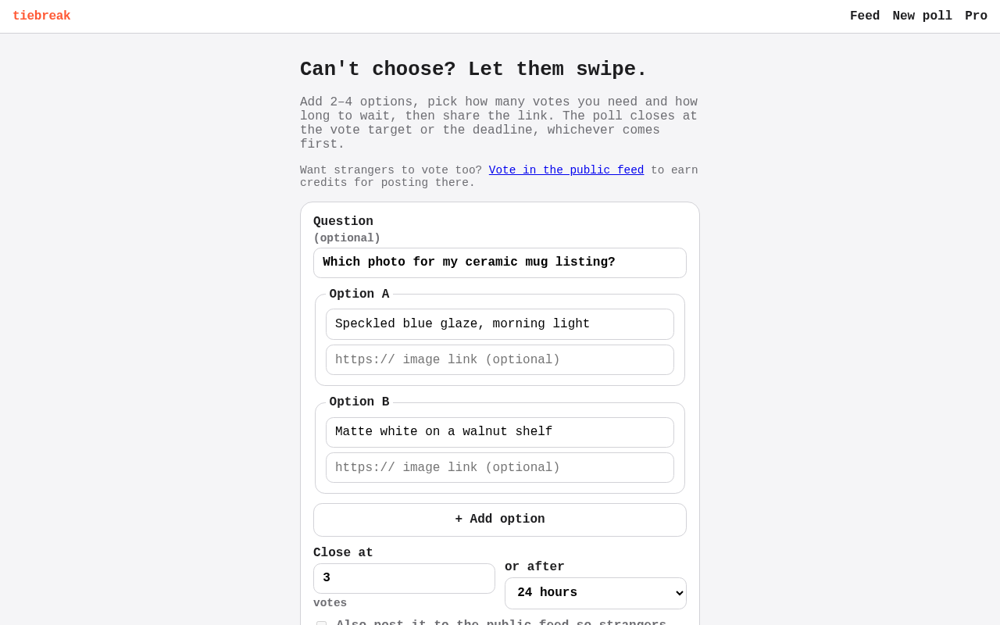
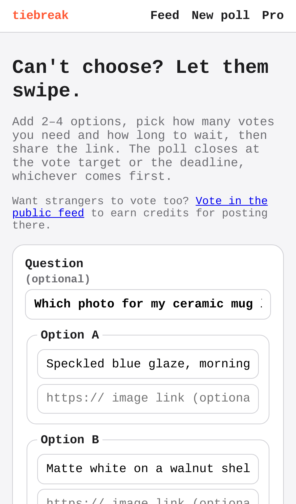
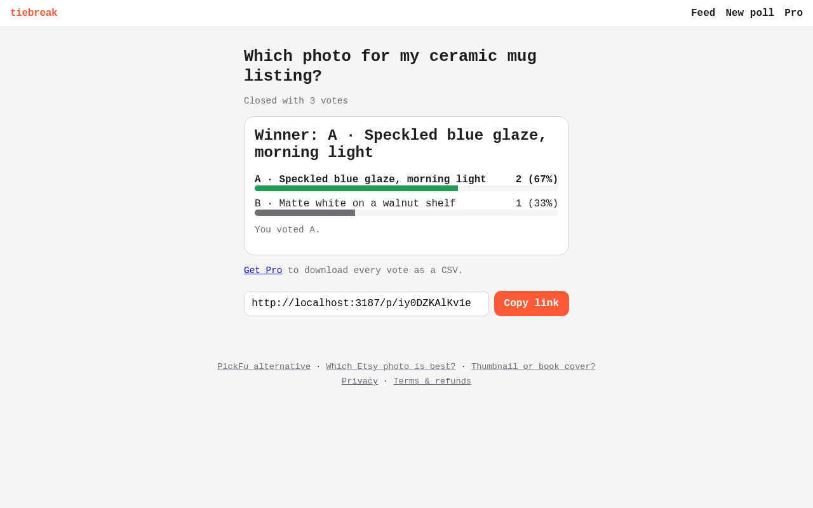
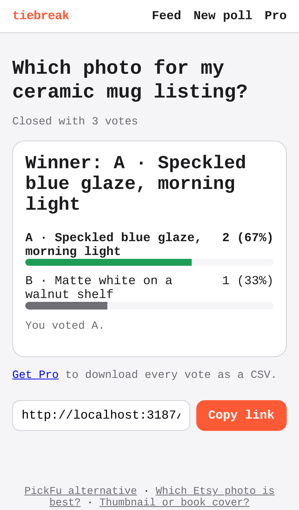
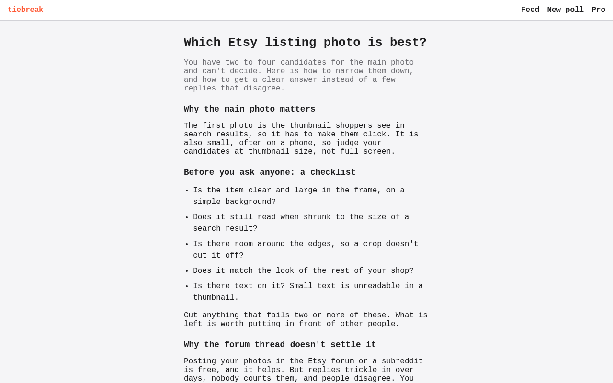
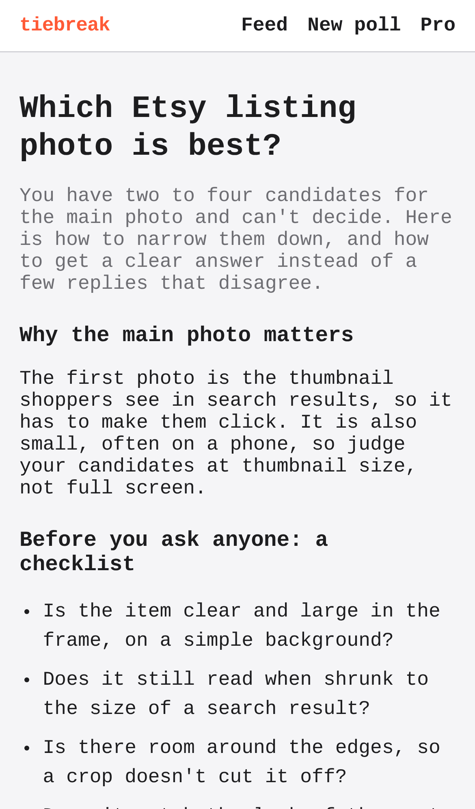

# tiebreak — swipe-to-decide polls for indecisive people and sellers

## Screenshots

The core action, posting a poll: a question, two options and a vote target, no sign-up.

Its result: two strangers voted on the shared link, the creator swiped the third vote, and the poll closed with the winner and the split (2 to 1).

One of the three public search pages (a PickFu alternative, which Etsy photo is best, a thumbnail or book cover): a useful answer to what a buyer searches, ending in a link to post a poll. All three are in the sitemap and linked from the footer (seen under the result above) and the home page.

Regenerate them with `npm run screenshots` (set `CHROMIUM_PATH` to a Chromium binary; it starts the dev server on an in-memory database, with sample data only).

People post two options, strangers swipe to pick one, and the poll closes at a vote target or deadline; sellers and creators pay a few dollars for a fast verdict instead of PickFu's $15+.

- [Research](RESEARCH.md) — findings and sources
- [PRD](PRD.md)
- [Roadmap](ROADMAP.md)
- [Native app](mobile/README.md): iPhone and Android (Expo), on the same API. Run it on your phone with Expo Go.

Effort: Medium · Confidence: Low

_Researched by the idea pipeline on 2026-10-11 ([original record](https://github.com/smithdavedesign/idea-factory/tree/main/ideas/tiebreak)); repo created on David's go-ahead 2026-10-11._

## Starter content (house polls)
The public feed is stocked with 40 funny "house" polls (`lib/house.ts`: horse-sized duck, is a hot dog a sandwich, …). Each question keeps one open public poll; when it closes, the next feed read posts a fresh copy, so the feed never runs dry. People's polls always come first, and anyone who voted on a house question doesn't see it again. Edit the list to change them; `HOUSE_POLLS=off` in the Vercel env turns them off.
