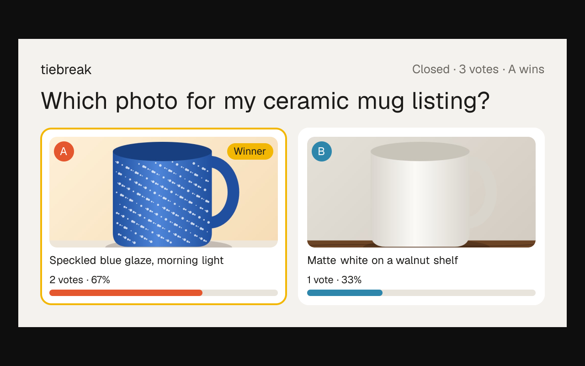
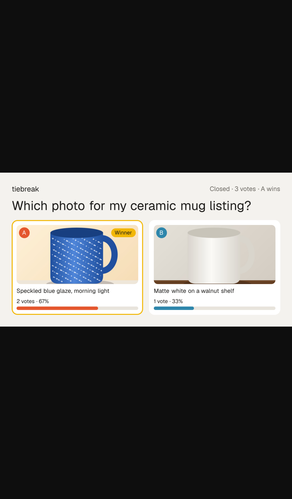

# tiebreak — swipe-to-decide polls for indecisive people and sellers

## Screenshots

The core action, posting a poll: a question and two options, each with a photo picked from the device.

New: a stranger opened the shared link in their own browser and picked A. Below their vote, "Make your own tiebreak" goes to the start page as `/?ref=poll` (the script follows it).

New: the poll's own share card, the 1200×630 PNG at `/p/<id>/card` that its link now unfurls as. Two more strangers voted, the poll closed, and the card marks the winning photo with each option's votes and share. The script also checks that the poll page's `og:image` and `twitter:image` (`summary_large_image`) name this card.

Regenerate them with `npm run screenshots` (set `CHROMIUM_PATH` to a Chromium binary; it starts the dev server on an in-memory database, with sample data only; the two mug photos are drawn in the browser).

People post two options, strangers swipe to pick one, and the poll closes at a vote target or deadline; sellers and creators pay a few dollars for a fast verdict instead of PickFu's $15+.

- [Research](RESEARCH.md) — findings and sources
- [PRD](PRD.md)
- [Roadmap](ROADMAP.md)
- [Native app](mobile/README.md): iPhone and Android (Expo), on the same API. Run it on your phone with Expo Go.

Effort: Medium · Confidence: Low

_Researched by the idea pipeline on 2026-10-11 ([original record](https://github.com/smithdavedesign/idea-factory/tree/main/ideas/tiebreak)); repo created on David's go-ahead 2026-10-11._

## Starter content (house polls)
The public feed is stocked with 40 funny "house" polls (`lib/house.ts`: horse-sized duck, is a hot dog a sandwich, …). Each question keeps one open public poll; when it closes, the next feed read posts a fresh copy, so the feed never runs dry. People's polls always come first, and anyone who voted on a house question doesn't see it again. Edit the list to change them; `HOUSE_POLLS=off` in the Vercel env turns them off.
