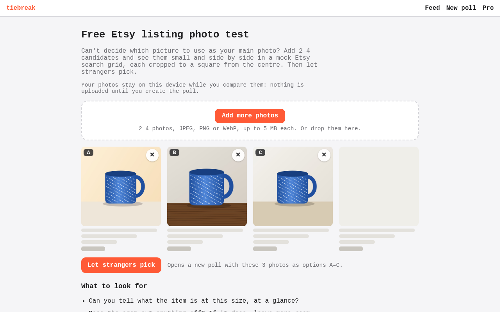
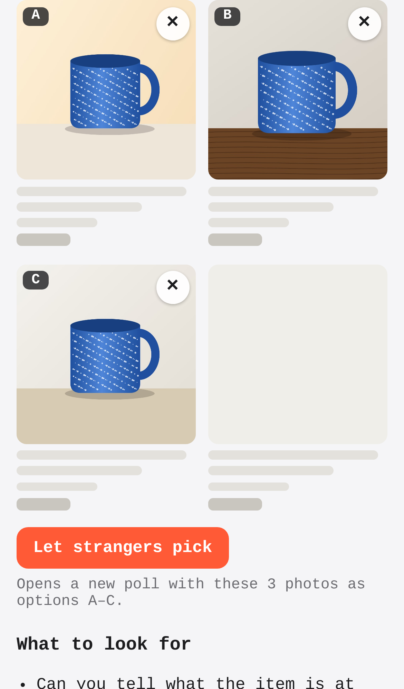
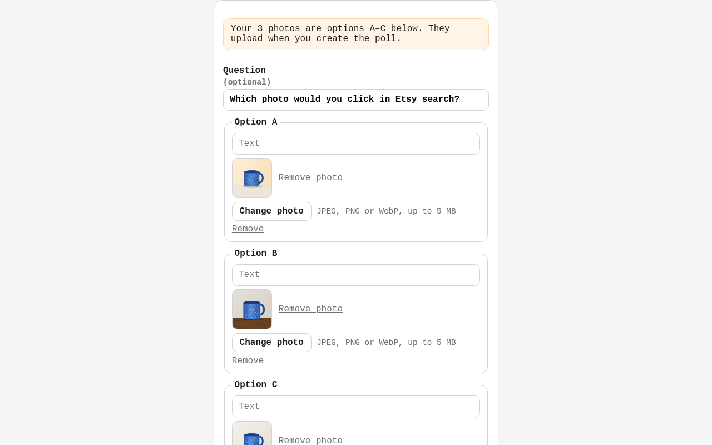
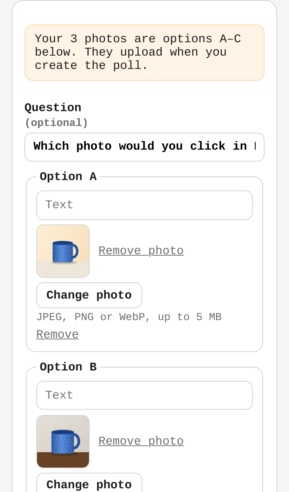
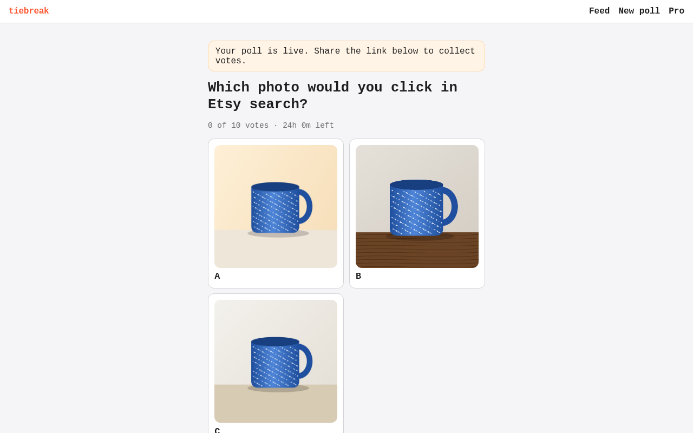
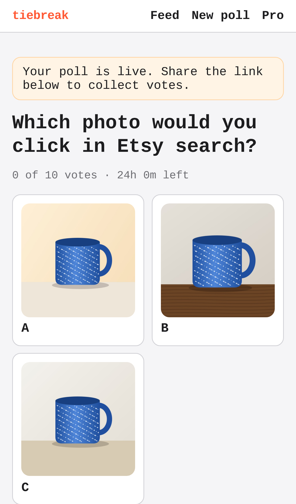

# tiebreak — swipe-to-decide polls for indecisive people and sellers

## Screenshots

The free Etsy listing photo test (`/tools/etsy-listing-photo-test`): three candidate photos of one mug, shot wide, tall and square, each cropped to a square tile side by side in a mock Etsy search grid. Nothing has been uploaded yet.

"Let strangers pick" opens the existing new-poll form with the three photos as options A–C and the question "Which photo would you click in Etsy search?". They upload only when the poll is created.

The poll it created: all three photos, served by tiebreak, ready for votes on the share link.

Regenerate them with `npm run screenshots` (set `CHROMIUM_PATH` to a Chromium binary; it starts the dev server on an in-memory database, with sample data only; the three mug photos are drawn in the browser).

People post two options, strangers swipe to pick one, and the poll closes at a vote target or deadline; sellers and creators pay a few dollars for a fast verdict instead of PickFu's $15+.

- [Research](RESEARCH.md) — findings and sources
- [PRD](PRD.md)
- [Roadmap](ROADMAP.md)
- [Native app](mobile/README.md): iPhone and Android (Expo), on the same API. Run it on your phone with Expo Go.

Effort: Medium · Confidence: Low

_Researched by the idea pipeline on 2026-10-11 ([original record](https://github.com/smithdavedesign/idea-factory/tree/main/ideas/tiebreak)); repo created on David's go-ahead 2026-10-11._

## Starter content (house polls)
The public feed is stocked with 40 funny "house" polls (`lib/house.ts`: horse-sized duck, is a hot dog a sandwich, …). Each question keeps one open public poll; when it closes, the next feed read posts a fresh copy, so the feed never runs dry. People's polls always come first, and anyone who voted on a house question doesn't see it again. Edit the list to change them; `HOUSE_POLLS=off` in the Vercel env turns them off.
