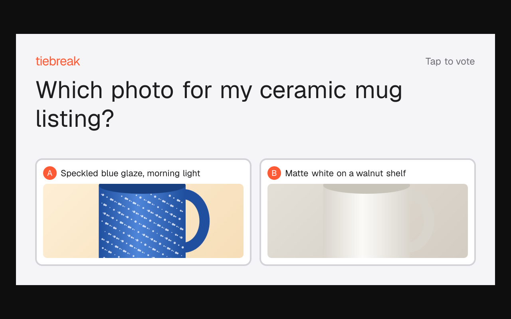
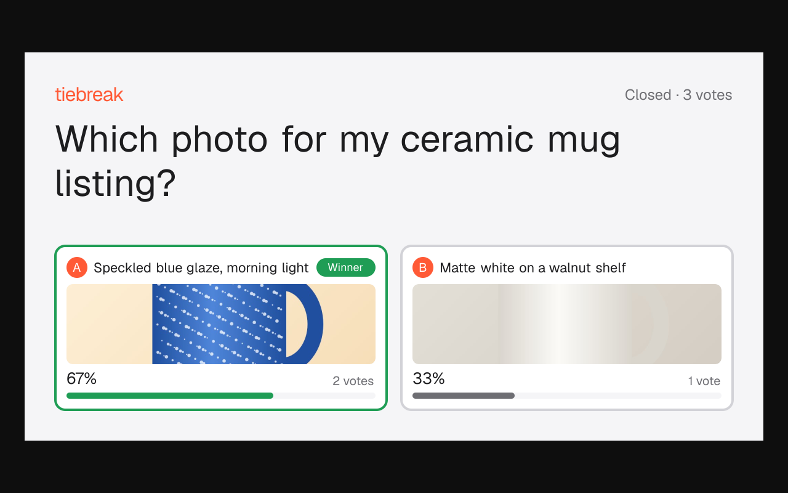
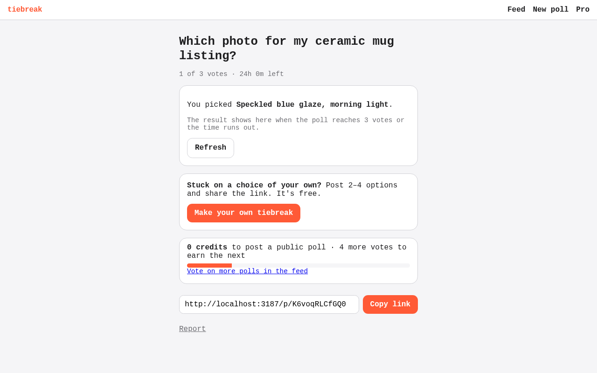
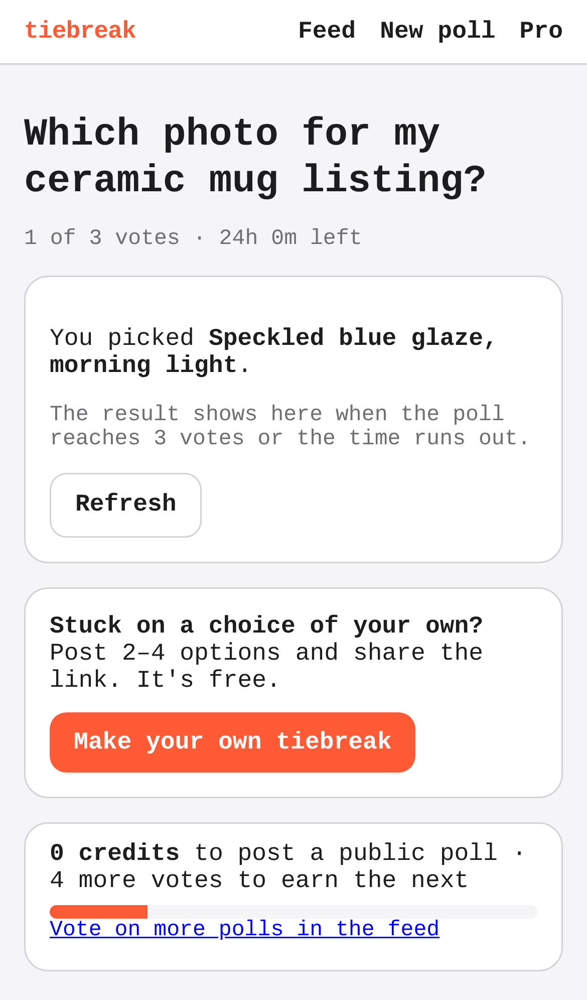

# tiebreak — swipe-to-decide polls for indecisive people and sellers

## Screenshots

What a poll's link now unfurls as in chats and on social sites (its `og:image` and `twitter:image`, drawn by `GET /p/:id/card` at 1200×630): the poll's own question and both of the seller's photos, not plain text.

Once the poll closes, the same link's card shows the result: the winner framed and labelled, and each option's share of the 3 votes.

A stranger opened the shared link and voted (the core action for a voter); the page now offers "Make your own tiebreak".

Following it opens the start page at `/?ref=poll`, where they can post their own poll; the visit counter records the `ref=poll` tag.

Regenerate them with `npm run screenshots` (set `CHROMIUM_PATH` to a Chromium binary; it starts the dev server on an in-memory database, with sample data only; the two mug photos are drawn in the browser). The cards are images, so they're taken once, at desktop size.

People post two options, strangers swipe to pick one, and the poll closes at a vote target or deadline; sellers and creators pay a few dollars for a fast verdict instead of PickFu's $15+.

- [Research](RESEARCH.md) — findings and sources
- [PRD](PRD.md)
- [Roadmap](ROADMAP.md)
- [Native app](mobile/README.md): iPhone and Android (Expo), on the same API. Run it on your phone with Expo Go.

Effort: Medium · Confidence: Low

_Researched by the idea pipeline on 2026-10-11 ([original record](https://github.com/smithdavedesign/idea-factory/tree/main/ideas/tiebreak)); repo created on David's go-ahead 2026-10-11._

## Starter content (house polls)
The public feed is stocked with 40 funny "house" polls (`lib/house.ts`: horse-sized duck, is a hot dog a sandwich, …). Each question keeps one open public poll; when it closes, the next feed read posts a fresh copy, so the feed never runs dry. People's polls always come first, and anyone who voted on a house question doesn't see it again. Edit the list to change them; `HOUSE_POLLS=off` in the Vercel env turns them off.
