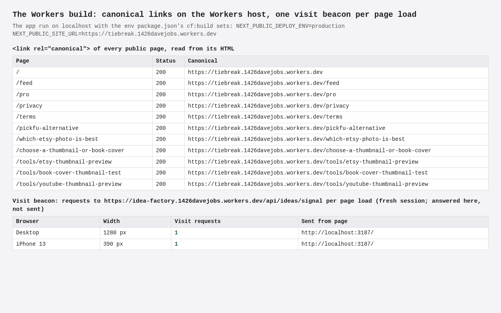

# tiebreak — swipe-to-decide polls for indecisive people and sellers

## Screenshots


The old address sends everyone to the Workers site: `/`, `/polls/abc123` and `/polls/abc123?src=x` get a 308 to the same path and query (vercel.json's rule, run by a local stand-in for Vercel's router).



Built with the env the Workers deploy uses, every public page's canonical link is on the Workers host, and a page load sends exactly one visit beacon at desktop and phone width.


The start page, where a seller posts 2–4 options (opened from a poll's "Make your own tiebreak", `/?ref=poll`).


The core action and its result: a stranger opened the shared link and cast the third vote, which closed the poll with the winning photo and the split.

Regenerate them with `npm run screenshots` (set `CHROMIUM_PATH` to a Chromium binary). It starts the dev server with the Workers build's env on an in-memory database, with sample data only; the two mug photos are drawn in the browser, and the beacon's requests are answered locally, so nothing reaches RepoHQ. The deployed redirect and Workers site are checked by `tests/live-site.test.ts` (see GROWTH.md, 2026-11-07).

People post two options, strangers swipe to pick one, and the poll closes at a vote target or deadline; sellers and creators pay a few dollars for a fast verdict instead of PickFu's $15+.

- [Research](RESEARCH.md) — findings and sources
- [PRD](PRD.md)
- [Roadmap](ROADMAP.md)
- [Native app](mobile/README.md): iPhone and Android (Expo), on the same API. Run it on your phone with Expo Go.

Effort: Medium · Confidence: Low

_Researched by the idea pipeline on 2026-10-11 ([original record](https://github.com/smithdavedesign/idea-factory/tree/main/ideas/tiebreak)); repo created on David's go-ahead 2026-10-11._

## Starter content (house polls)
The public feed is stocked with 40 funny "house" polls (`lib/house.ts`: horse-sized duck, is a hot dog a sandwich, …). Each question keeps one open public poll; when it closes, the next feed read posts a fresh copy, so the feed never runs dry. People's polls always come first, and anyone who voted on a house question doesn't see it again. Edit the list to change them; `HOUSE_POLLS=off` in the Vercel env turns them off.

## Hosting on Cloudflare Workers (Vercel only redirects)

tiebreak runs on Cloudflare Workers (free plan) through the OpenNext adapter, at https://tiebreak.1426davejobs.workers.dev.
The old Vercel project (https://tiebreak-phi.vercel.app, the address in older links and posts) only redirects there:
`vercel.json` answers every path with a 308 to the same path and query string on Workers, and its build installs and
builds nothing (GROWTH.md, 2026-11-07). Vercel ignores the Workers files (`wrangler.jsonc`, `open-next.config.ts`, the
`cf:build`/`preview`/`deploy` scripts).

```bash
npm run cf:build                                   # next build, then .open-next/worker.js + static assets
npx wrangler dev                                   # run the built Worker locally (workerd); secrets from .dev.vars
provision cloudflare deploy tiebreak "$PWD"         # deploy with the broker (token from the keychain)
provision cloudflare secret tiebreak DATABASE_URL  # and STRIPE_PAYMENT_LINK, STRIPE_WEBHOOK_SECRET
```
`NEXT_PUBLIC_*` values are baked in at build time, so `cf:build` (and `npm run deploy`, which runs it) sets both:
`NEXT_PUBLIC_SITE_URL` to the Workers address, for canonical URLs, the sitemap and share cards (change it there for a
custom domain), and `NEXT_PUBLIC_DEPLOY_ENV=production`, so the visit beacon counts the Worker's visitors
(`lib/beacon.ts` `deployEnv()`). On Workers each query or transaction
gets its own Postgres connection (`lib/db.ts`), since a socket can't outlive the request that opened it.
Screenshots of the built Worker running locally are in `docs/screenshots/cloudflare-local/`.
