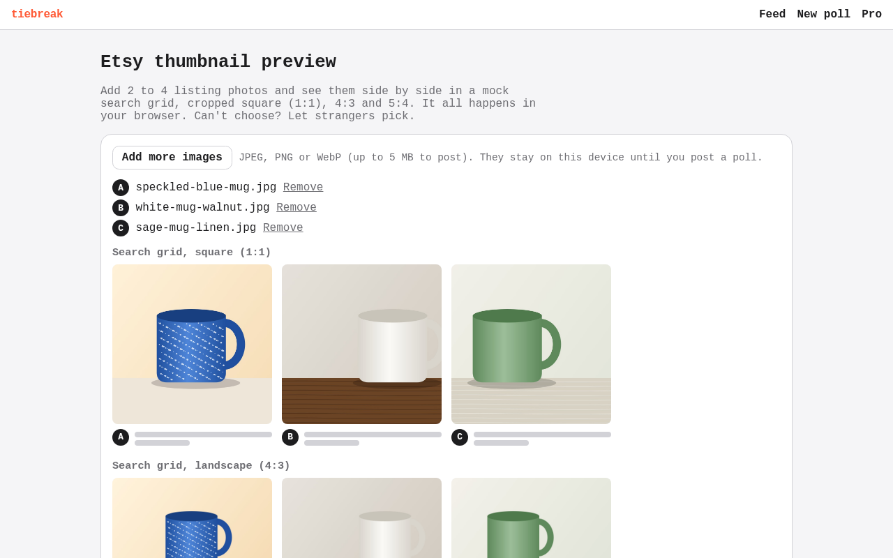
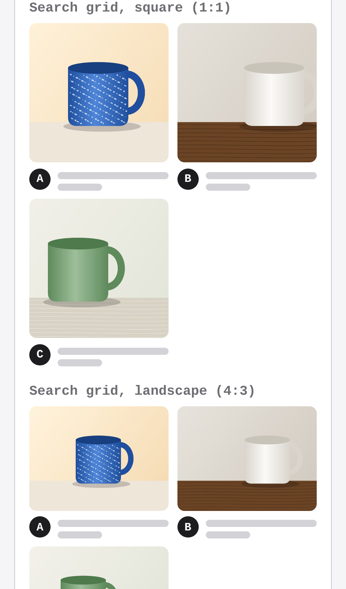
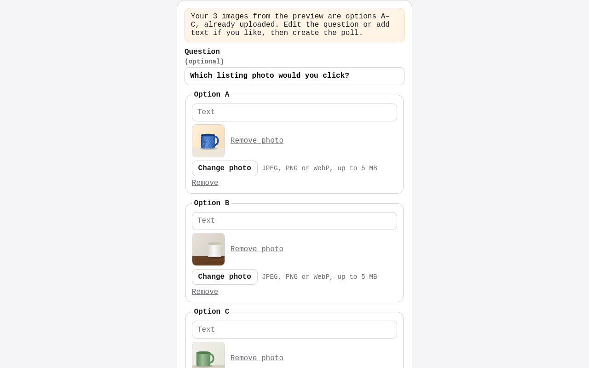
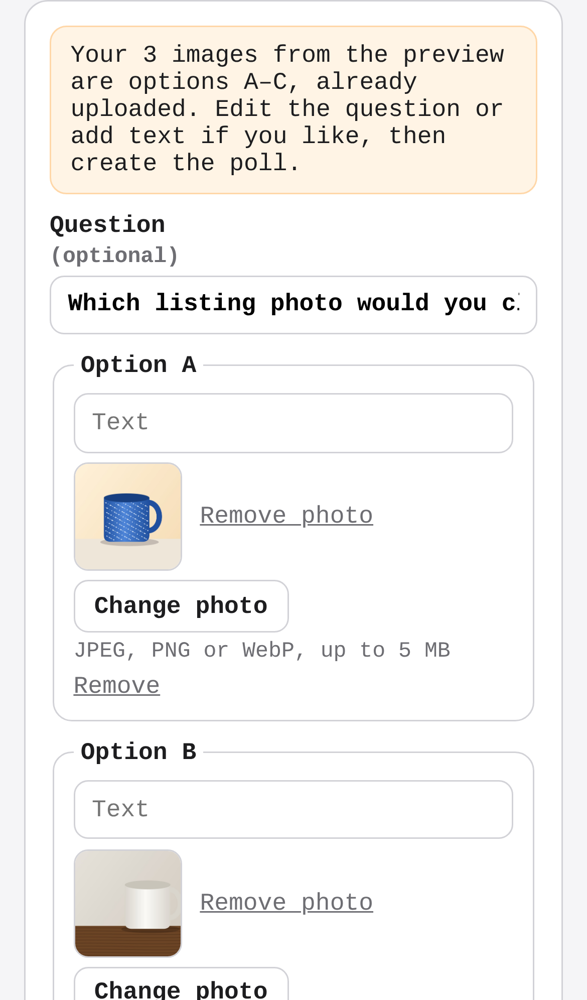

# tiebreak — swipe-to-decide polls for indecisive people and sellers

## Screenshots

The free Etsy thumbnail preview (`/tools/etsy-thumbnail-preview`): three listing photos added from the device show side by side in a mock search grid at the square, 4:3 and 5:4 crops, drawn in the browser with nothing uploaded. The book cover and YouTube tools work the same way.

"Let strangers pick": the photos upload once and the new-poll form opens with them as options A–C and the tool's question, ready to post.

The poll it posted: three sample votes on the shared link closed it at its target, with the winning photo and the split (2, 1, 0).

Regenerate them with `npm run screenshots` (set `CHROMIUM_PATH` to a Chromium binary; it starts the dev server on an in-memory database, with sample data only; the three mug photos are drawn in the browser).

People post two options, strangers swipe to pick one, and the poll closes at a vote target or deadline; sellers and creators pay a few dollars for a fast verdict instead of PickFu's $15+.

- [Research](RESEARCH.md) — findings and sources
- [PRD](PRD.md)
- [Roadmap](ROADMAP.md)
- [Native app](mobile/README.md): iPhone and Android (Expo), on the same API. Run it on your phone with Expo Go.

Effort: Medium · Confidence: Low

_Researched by the idea pipeline on 2026-10-11 ([original record](https://github.com/smithdavedesign/idea-factory/tree/main/ideas/tiebreak)); repo created on David's go-ahead 2026-10-11._

## Starter content (house polls)
The public feed is stocked with 40 funny "house" polls (`lib/house.ts`: horse-sized duck, is a hot dog a sandwich, …). Each question keeps one open public poll; when it closes, the next feed read posts a fresh copy, so the feed never runs dry. People's polls always come first, and anyone who voted on a house question doesn't see it again. Edit the list to change them; `HOUSE_POLLS=off` in the Vercel env turns them off.
