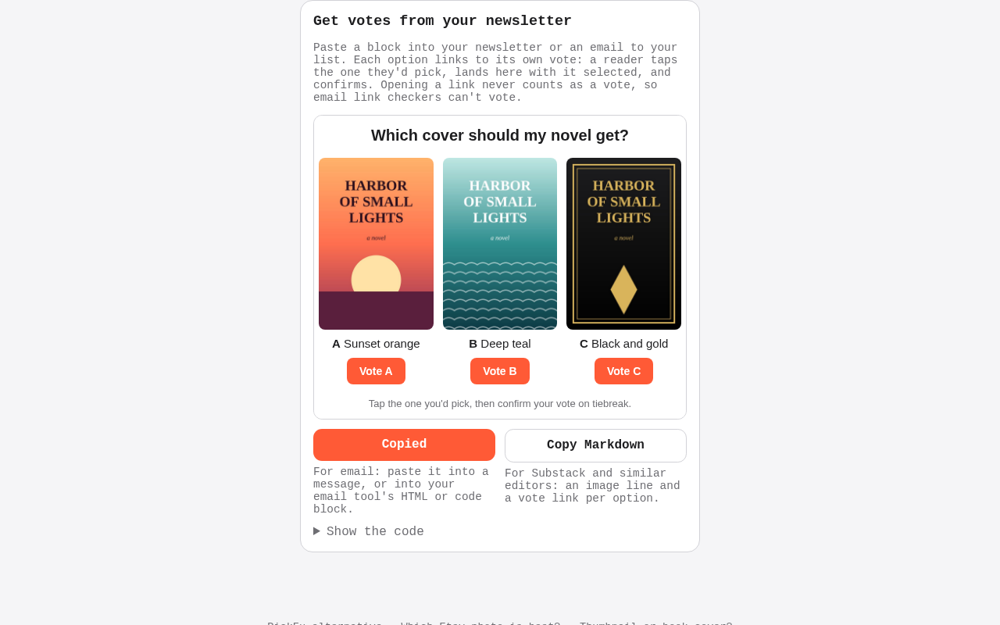
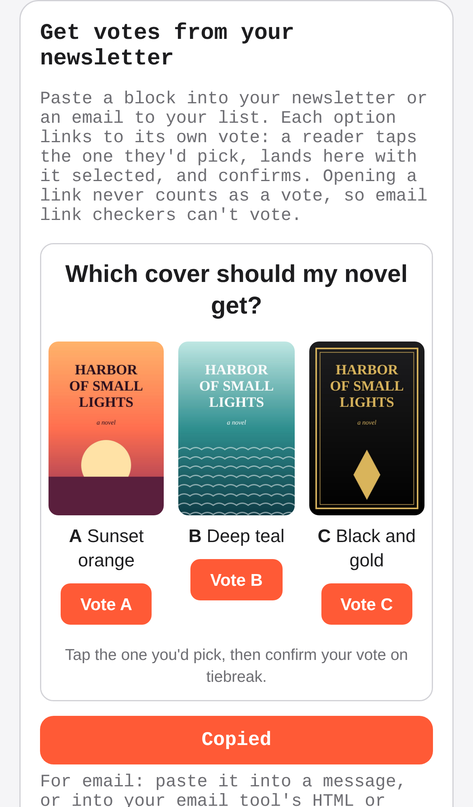
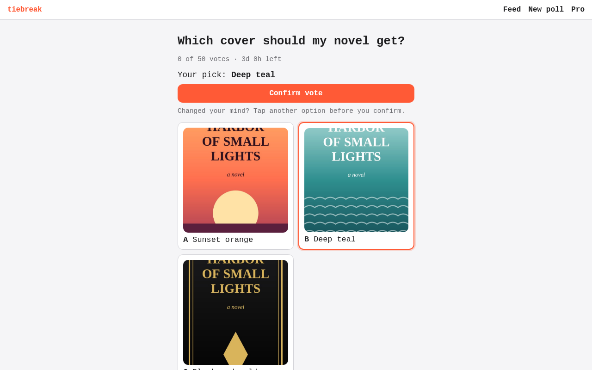
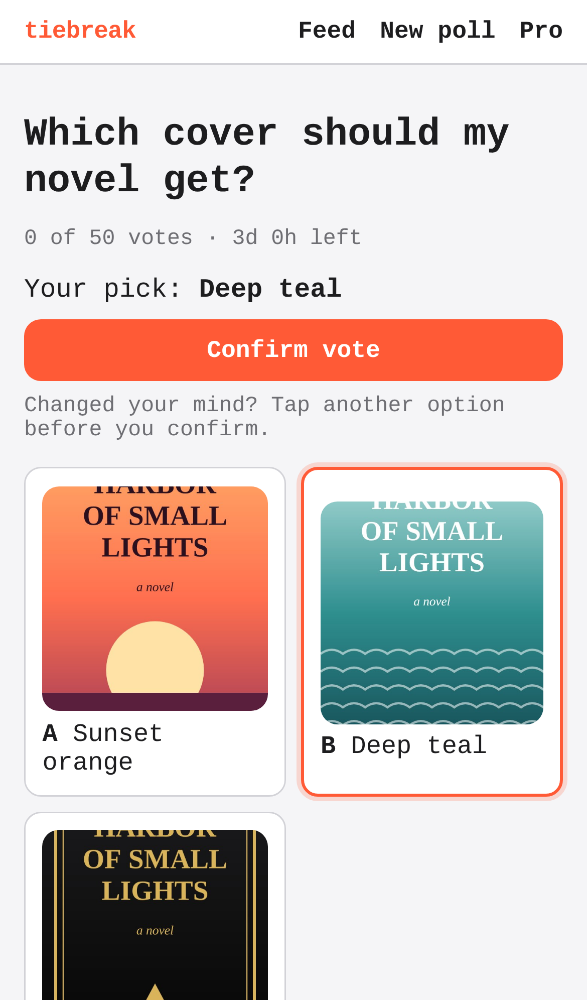

# tiebreak — swipe-to-decide polls for indecisive people and sellers

## Screenshots




An author posted a three-cover poll from the start page; their poll page now offers "Get votes from your newsletter": a preview of the email block (one link per cover) and two copy buttons, HTML for email and Markdown for Substack and similar editors. The HTML block has just been copied.




A reader tapped "Vote B" in that block (`/polls/<id>?pick=B&src=newsletter`): the poll opens with B preselected and one "Confirm vote" button, and the count is still 0, since opening a link never votes.


They confirmed: exactly one vote counts (1 of 50), and the address bar holds the plain share link again.

Regenerate them with `npm run screenshots` (set `CHROMIUM_PATH` to a Chromium binary; it starts the dev server on an in-memory database, with sample data only; the three covers are drawn in the browser). `tests/newsletter-browser.test.ts` runs the same flow at both sizes, including a second confirm (409) and a closed poll's link.

People post two options, strangers swipe to pick one, and the poll closes at a vote target or deadline; sellers and creators pay a few dollars for a fast verdict instead of PickFu's $15+.

- [Research](RESEARCH.md) — findings and sources
- [PRD](PRD.md)
- [Roadmap](ROADMAP.md)
- [Native app](mobile/README.md): iPhone and Android (Expo), on the same API. Run it on your phone with Expo Go.

Effort: Medium · Confidence: Low

_Researched by the idea pipeline on 2026-10-11 ([original record](https://github.com/smithdavedesign/idea-factory/tree/main/ideas/tiebreak)); repo created on David's go-ahead 2026-10-11._

## Starter content (house polls)
The public feed is stocked with 40 funny "house" polls (`lib/house.ts`: horse-sized duck, is a hot dog a sandwich, …). Each question keeps one open public poll; when it closes, the next feed read posts a fresh copy, so the feed never runs dry. People's polls always come first, and anyone who voted on a house question doesn't see it again. Edit the list to change them; `HOUSE_POLLS=off` in the Vercel env turns them off.

## Hosting on Cloudflare Workers (being prepared)

The Vercel team is soft-blocked until 2026-11-30, so tiebreak can also run on Cloudflare Workers (free plan) through
the OpenNext adapter. Vercel ignores all of it (`wrangler.jsonc`, `open-next.config.ts`, the `cf:build`/`preview`/`deploy`
scripts), so both hosts build from the same code until the switch.

```bash
npm run cf:build                                   # next build, then .open-next/worker.js + static assets
npx wrangler dev                                   # run the built Worker locally (workerd); secrets from .dev.vars
provision cloudflare deploy tiebreak "$PWD"         # deploy with the broker (token from the keychain)
provision cloudflare secret tiebreak DATABASE_URL  # and STRIPE_PAYMENT_LINK, STRIPE_WEBHOOK_SECRET
```
`NEXT_PUBLIC_*` values are baked in at build time: build production with `NEXT_PUBLIC_SITE_URL=<its address>`.
`cf:build` sets `NEXT_PUBLIC_DEPLOY_ENV=production` itself, so the visit beacon counts the Worker's visitors
(`lib/beacon.ts` `deployEnv()`; on Vercel it reads `NEXT_PUBLIC_VERCEL_ENV`). On Workers each query or transaction
gets its own Postgres connection (`lib/db.ts`), since a socket can't outlive the request that opened it.
Screenshots of the built Worker running locally are in `docs/screenshots/cloudflare-local/`.
