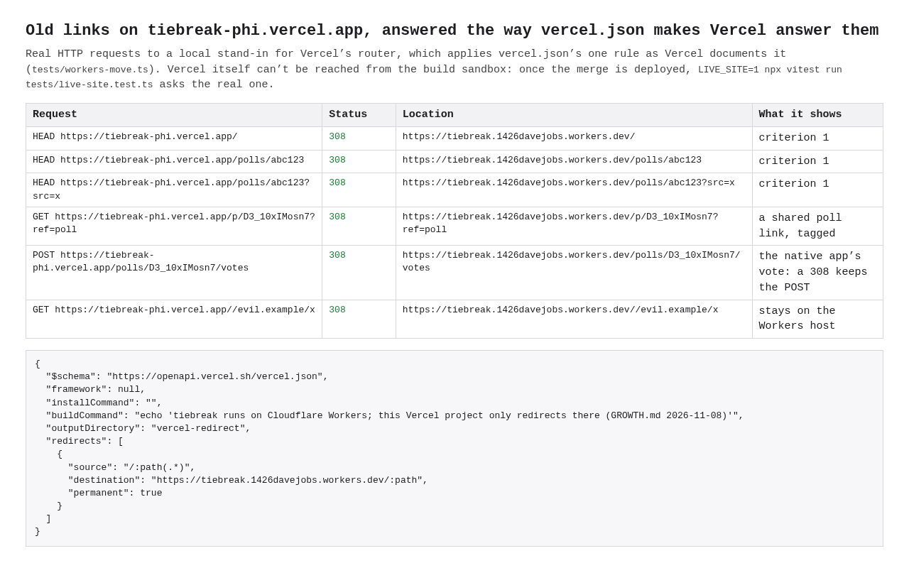
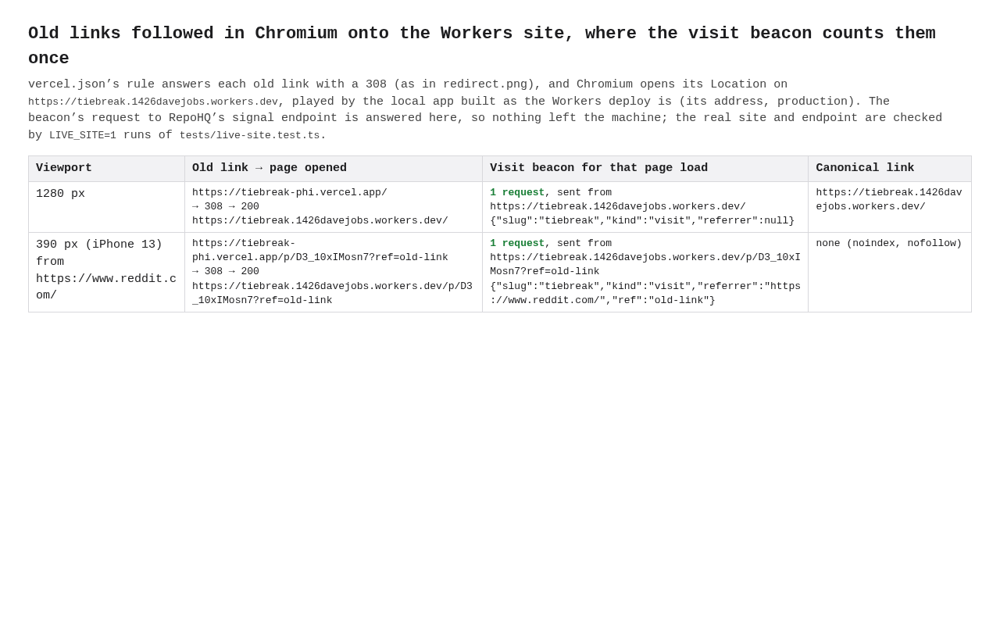
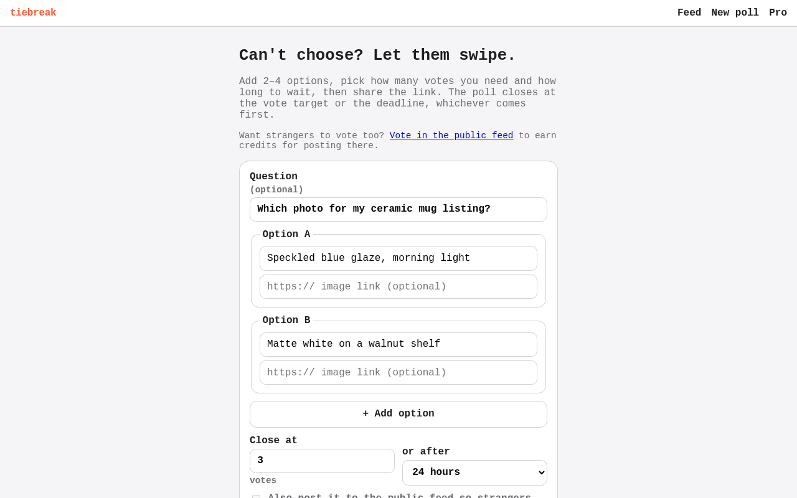
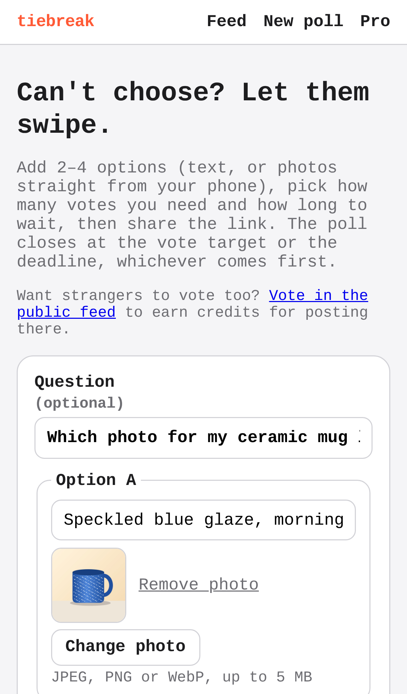

# tiebreak — swipe-to-decide polls for indecisive people and sellers

## Screenshots



The old address now redirects (`vercel.json`): every request, `/polls/abc123?src=x` included, gets a 308 to the same path and query on https://tiebreak.1426davejobs.workers.dev. These answers come from a local stand-in that applies the rule as Vercel documents it; `tests/live-site.test.ts` asks the real address once the merge is deployed.



Followed in Chromium at 1280 and 390 px, an old link lands on the Workers address, and that page load sends exactly one visit beacon (a shared poll link keeps its `ref` tag and its Reddit referrer). The local app plays the Workers site, and the beacon is answered locally.




The main job, unchanged: on the start page a seller fills in a poll, with a photo for each option, and posts it.


The result, after three strangers voted: the poll closed at its target, with the winning photo and the split (67% to 33%).

Regenerate them with `npm run screenshots` (set `CHROMIUM_PATH` to a Chromium binary; it starts the dev server on an in-memory database, with sample data only; the two mug photos are drawn in the browser).

People post two options, strangers swipe to pick one, and the poll closes at a vote target or deadline; sellers and creators pay a few dollars for a fast verdict instead of PickFu's $15+.

- [Research](RESEARCH.md) — findings and sources
- [PRD](PRD.md)
- [Roadmap](ROADMAP.md)
- [Native app](mobile/README.md): iPhone and Android (Expo), on the same API. Run it on your phone with Expo Go.

Effort: Medium · Confidence: Low

_Researched by the idea pipeline on 2026-10-11 ([original record](https://github.com/smithdavedesign/idea-factory/tree/main/ideas/tiebreak)); repo created on David's go-ahead 2026-10-11._

## Starter content (house polls)
The public feed is stocked with 40 funny "house" polls (`lib/house.ts`: horse-sized duck, is a hot dog a sandwich, …). Each question keeps one open public poll; when it closes, the next feed read posts a fresh copy, so the feed never runs dry. People's polls always come first, and anyone who voted on a house question doesn't see it again. Edit the list to change them; `HOUSE_POLLS=off` in the host's env turns them off.

## Hosting on Cloudflare Workers

tiebreak runs on Cloudflare Workers (free plan), through the OpenNext adapter, at https://tiebreak.1426davejobs.workers.dev.
The old Vercel address, https://tiebreak-phi.vercel.app, only redirects there: `vercel.json` answers every request with a
308 to the same path and query string, and Vercel's build installs and builds nothing (GROWTH.md, 2026-11-08). Vercel
ignores the Workers files (`wrangler.jsonc`, `open-next.config.ts`, the `cf:build`/`preview`/`deploy` scripts).

```bash
npm run cf:build                                   # next build, then .open-next/worker.js + static assets
npx wrangler dev                                   # run the built Worker locally (workerd); secrets from .dev.vars
provision cloudflare deploy tiebreak "$PWD"         # deploy with the broker (token from the keychain)
provision cloudflare secret tiebreak DATABASE_URL  # and STRIPE_PAYMENT_LINK, STRIPE_WEBHOOK_SECRET
```
`NEXT_PUBLIC_*` values are baked in at build time. Canonical URLs, the sitemap and share cards name the Workers site
with nothing set: it's the default in `lib/site.ts`. Set `NEXT_PUBLIC_SITE_URL` only for a custom domain. Every page
has a canonical link there: the public pages and poll pages name their own address, and 404s name the home page.
`cf:build` sets `NEXT_PUBLIC_DEPLOY_ENV=production` itself, so the visit beacon counts the Worker's visitors
(`lib/beacon.ts` `deployEnv()`). On Workers each query or transaction
gets its own Postgres connection (`lib/db.ts`), since a socket can't outlive the request that opened it.
Screenshots of the built Worker running locally are in `docs/screenshots/cloudflare-local/`.
